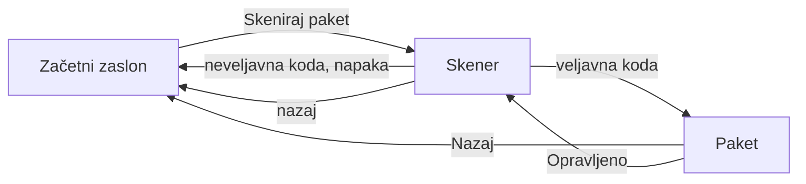
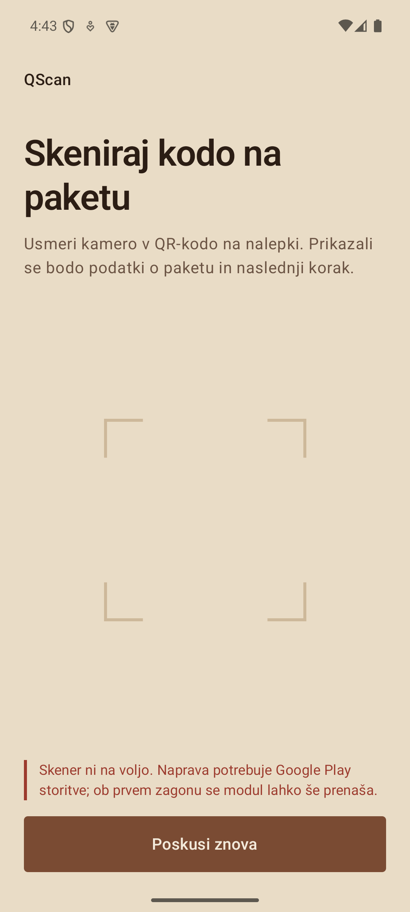
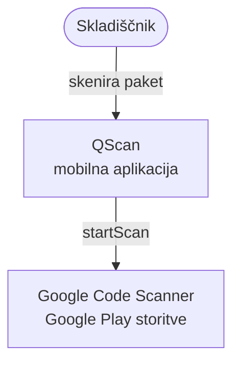
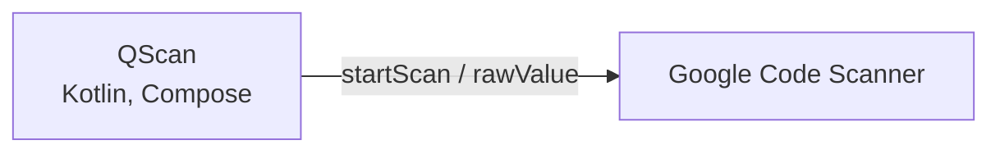
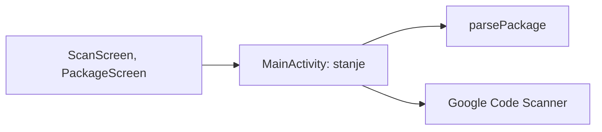
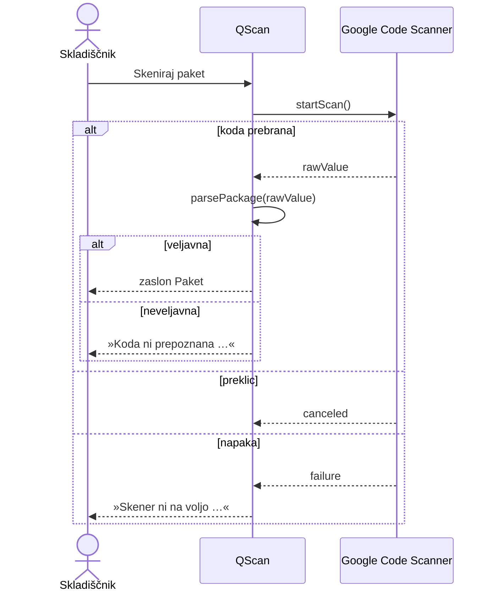
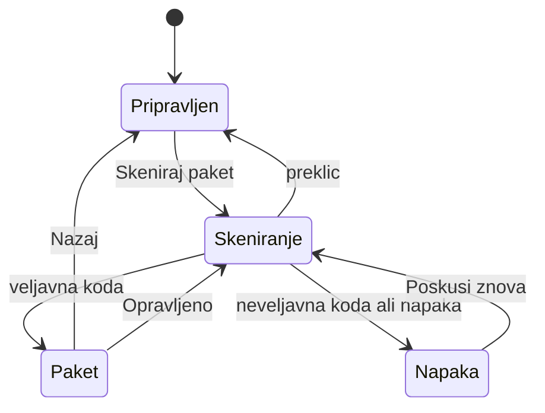

# QScan: funkcionalna specifikacija

| | |
|---|---|
| **Člani** | Tilen Butara, Luka Ažman |
| **Repozitorij** | https://github.com/butarca/QScan |
| **Platforma in orodja** | Android, Kotlin + Jetpack Compose |
| **Različica dokumenta** | 0.2, 27. 11. 2026 |

---

## 1. Uvod

### 1.1 Namen

Skladiščni delavec mora pri vsakem paketu vedeti, kaj z njim narediti. QScan prebere QR-kodo na paketu in pokaže številko paketa, datum, lokacijo in opravilo. Delavcu podatkov ni treba iskati ročno.

### 1.2 Uporabniki

| Vloga | Opis |
|---|---|
| Skladiščnik | Prevzema in obdeluje pakete. Želi takoj vedeti, kaj mora s paketom narediti. |

### 1.3 Obseg

**Aplikacija omogoča:**

- skeniranje QR-kode na paketu,
- prikaz številke paketa, datuma, lokacije, opombe in opravila,
- obvestilo ob neveljavni kodi in ponovni poskus.

**Izven obsega** (1. faza):

- prijava zaposlenih in strežnik (2. faza),
- zgodovina skeniranj (2. faza),
- urnik opravil (3. faza),
- shranjevanje podatkov na napravi.

### 1.4 Slovar pojmov

| Pojem | Pomen v tej aplikaciji |
|---|---|
| Paket | Pošiljka v skladišču z enolično številko, npr. `PKG-000123`. |
| Opravilo | Korak, ki ga mora skladiščnik narediti: pregled, premik ali odprema. |
| Lokacija | Mesto v skladišču, npr. `A-03-2` ali `Rampa 2`. |
| QScan koda | QR-koda, ki vsebuje JSON v obliki iz poglavja 6. |

---

## 2. Funkcionalne zahteve

### US-01: Skeniranje kode

**Kot** skladiščnik **želim** s kamero skenirati QR-kodo na paketu, **da** mi podatkov ni treba iskati ročno.

**Prioriteta:** Must

```gherkin
Scenario: veljavna koda
  Given skladiščnik je na začetnem zaslonu
  When tapne »Skeniraj paket« in skenira veljavno QScan kodo
  Then se odpre zaslon paketa

Scenario: skener ni na voljo
  Given na napravi ni Google Play storitev ali modul skenerja še ni prenesen
  When skladiščnik tapne »Skeniraj paket«
  Then se izpiše »Skener ni na voljo. …«
  And gumb se glasi »Poskusi znova«

Scenario: preklic
  Given skener je odprt
  When skladiščnik pritisne nazaj
  Then se vrne na začetni zaslon brez obvestila
```

### US-02: Prikaz paketa

**Kot** skladiščnik **želim** po skeniranju videti številko paketa, datum, lokacijo in opravilo, **da** vem, kaj moram narediti s paketom.

**Prioriteta:** Must

```gherkin
Scenario: vsi podatki
  Given koda vsebuje {"v":1,"id":"PKG-000123","date":"2026-11-26","task":"MOVE","loc":"A-03-2"}
  When skladiščnik skenira kodo
  Then vidi »PKG-000123«, opravilo »Premik«, lokacijo »A-03-2« in datum »26. 11. 2026«

Scenario: manjkajoča neobvezna polja
  Given koda vsebuje samo "v", "id" in "task"
  When skladiščnik skenira kodo
  Then vidi številko paketa in opravilo
  And vrstic za datum, lokacijo in opombo ni
```

### US-03: Neveljavna koda

**Kot** skladiščnik **želim** obvestilo, kadar koda ni QScan koda, **da** ne ukrepam na podlagi napačnih podatkov.

**Prioriteta:** Must

```gherkin
Scenario: koda s spletnim naslovom
  Given skladiščnik je na začetnem zaslonu
  When skenira kodo z vsebino »https://example.com/to-ni-paket«
  Then ostane na začetnem zaslonu
  And izpiše se »Koda ni prepoznana kot QScan paket. Preveri nalepko in poskusi znova.«

Scenario: nepodprta verzija
  Given skladiščnik je na začetnem zaslonu
  When skenira kodo z "v":2
  Then se izpiše isto obvestilo
```

### US-04: Naslednji paket

**Kot** skladiščnik **želim** po opravljenem koraku takoj skenirati naslednji paket, **da** hitreje obdelam več paketov.

**Prioriteta:** Should

```gherkin
Scenario: opravljeno
  Given skladiščnik je na zaslonu paketa
  When tapne »Opravljeno, skeniraj naslednjega«
  Then se odpre skener

Scenario: nazaj brez potrditve
  Given skladiščnik je na zaslonu paketa
  When tapne »Nazaj« ali sistemski gumb nazaj
  Then se vrne na začetni zaslon
```

### Won't (zavestno izpuščeno)

- Prijava in zgodovina skeniranj: zahtevata strežnik, ki pride v 2. fazi.
- Urnik opravil: 3. faza.
- Lasten zaslon s kamero: Google Code Scanner že pokrije skeniranje brez dovoljenja za kamero.

---

## 3. Nefunkcionalne zahteve

| Oznaka | Kategorija | Zahteva | Kako preverimo |
|---|---|---|---|
| NFR-01 | Zmogljivost | Zaslon paketa se prikaže v manj kot 1 s po skeniranju na emulatorju z Androidom 15 (API 35). | Merjenje od zaprtja skenerja do prikaza zaslona. |
| NFR-02 | Dostopnost | Vse dotikalne površine so velike vsaj 48 × 48 dp, glavna gumba 56 dp. | Pregled v Layout Inspectorju. |
| NFR-03 | Dostopnost | Kontrast besedila je vsaj 4,5 : 1 v svetli in temni temi. | Izračun za vse barvne pare teme (najnižji je 5,04 : 1). |
| NFR-04 | Združljivost | Android 7.0 (API 24) ali novejši z Google Play storitvami. | `minSdk = 24` v `app/build.gradle.kts`. |
| NFR-05 | Varnost (MASVS-CODE) | Neveljavna vsebina kode nikoli ne odpre zaslona paketa. | `PackageParserTest`, testni kodi 04 in 05. |
| NFR-06 | Varnost (MASVS-PLATFORM) | Aplikacija ne zahteva dovoljenja `CAMERA`. Kamero upravlja Google Code Scanner. | Pregled `AndroidManifest.xml`. |
| NFR-07 | Zanesljivost | Aplikacija ne uporablja omrežja, zato deluje brez povezave. Izjema je prvi prenos modula skenerja. | Skeniranje v načinu letala. |

### 3.1 Osebni podatki in dovoljenja

Aplikacija ne zbira osebnih podatkov in ne zahteva dovoljenj. Slika s kamere ostane v Google Code Scannerju, aplikacija dobi samo besedilo kode in ga ne shrani.

---

## 4. Uporabniški vmesnik

### 4.1 Tok zaslonov



### 4.2 Zasloni

#### Začetni zaslon



Navodilo in gumb »Skeniraj paket«. Ob napaki se nad gumbom izpiše obvestilo, gumb se preimenuje v »Poskusi znova«. **Pokriva:** US-01, US-03

#### Skener

Googlov zaslon s kamero. Ko prepozna QR-kodo, se sam zapre. **Pokriva:** US-01

#### Paket

Skica manjka; posnetek dodava po preizkusu na telefonu.

Od zgoraj navzdol: gumb »Nazaj«, številka paketa, opravilo z navodilom (npr. »Premik: premakni paket na navedeno lokacijo.«), lokacija, datum, opomba in spodaj gumb »Opravljeno, skeniraj naslednjega«. **Pokriva:** US-02, US-04

---

## 5. Arhitektura

### 5.1 Kontekst (C4, raven 1)



### 5.2 Vsebniki (C4, raven 2)

V 1. fazi QScan nima strežnika ali baze. Edina zunanja storitev je Google Code Scanner na napravi. Strežnik (Node.js, MariaDB) pride v 2. fazi.



### 5.3 Plasti aplikacije

Aplikacija ima eno aktivnost. Zaslona sta Compose funkciji `ScanScreen` in `PackageScreen`. Stanje (vsebina zadnje kode in napaka) je v `MainActivity` v `rememberSaveable`, zato preživi obračanje zaslona. Funkcija `parsePackage` iz vsebine kode naredi `PackageInfo`. Repozitorija in ViewModela v 1. fazi ni, ker ni podatkovnega vira; dodava ju v 2. fazi.



---

## 6. Podatkovni model

Aplikacija ničesar ne shranjuje. Edini podatek je vsebina QScan kode, JSON z enim objektom:

```json
{"v":1,"id":"PKG-000123","date":"2026-11-26","task":"MOVE","loc":"A-03-2","note":"Krhko, ne zlagaj."}
```

### Paket (vsebina kode)

| Atribut | Tip | Obvezen | Opis |
|---|---|---|---|
| `v` | število | da | verzija formata, samo `1` |
| `id` | string | da | številka paketa, ne sme biti prazna |
| `task` | string | da | `INSPECT`, `MOVE` ali `SHIP` |
| `date` | string | ne | datum v obliki `YYYY-MM-DD` |
| `loc` | string | ne | lokacija v skladišču |
| `note` | string | ne | dodatno navodilo |

**Hramba:** samo v QR-kodi. Aplikacija drži vsebino zadnje kode v pomnilniku, dokler je zaslon paketa odprt. V 2. fazi bo koda vsebovala samo `id`, podatki bodo na strežniku.

Testne kode so v [`test-qr/`](test-qr/), njihova vsebina v [`payloads.json`](test-qr/payloads.json).

---

## 7. Zunanji vmesniki

### 7.1 Google Code Scanner

| | |
|---|---|
| **Namen** | branje QR-kode s kamero |
| **Dokumentacija** | https://developers.google.com/ml-kit/vision/barcode-scanning/code-scanner |
| **Avtentikacija** | brez |
| **Omejitve** | potrebne so Google Play storitve; modul se prenese ob namestitvi ali prvi uporabi |

**Zahteva:**

```kotlin
GmsBarcodeScanning.getClient(context, GmsBarcodeScannerOptions.Builder()
    .setBarcodeFormats(Barcode.FORMAT_QR_CODE).build())
    .startScan()
```

**Odgovor:** `Barcode.rawValue`, besedilo kode.

**Napake:** ob preklicu aplikacija ne pokaže ničesar. Ob napaki (ni Google Play storitev, modul se še prenaša) izpiše »Skener ni na voljo. …« in ponudi ponovni poskus.

### API-ji naprave

| API | Dovoljenje | Za kaj |
|---|---|---|
| kamera (prek Google Code Scannerja) | ni potrebno | skeniranje QR-kode |

---

## 8. Dinamika

### 8.1 Skeniranje paketa



### 8.2 Drugi potek

Ni ga. Aplikacija v 1. fazi nima oddaljenih podatkov, zato zadošča en sekvenčni diagram.

### 8.3 Stanja: zaslon aplikacije



### 8.4 Algoritem: preverjanje vsebine kode

- **Vhod:** besedilo kode (`String`)
- **Izhod:** `PackageInfo` ali `null`
- **Pravilo:** besedilo mora biti JSON objekt z `v = 1`, nepraznim `id` in `task` iz `INSPECT`, `MOVE`, `SHIP` (velikost črk ni pomembna). Če je `date` podan, mora ustrezati `\d{4}-\d{2}-\d{2}`. Prazni nizi in `null` pri neobveznih poljih pomenijo, da polja ni.
- **Robni primeri:** prazno besedilo, ne-JSON, JSON polje namesto objekta, `v = 2`, `id` samo s presledki, neznan `task`, datum `26.11.2026` → `null`.
- **Primer:** `{"v":1,"id":"PKG-1","task":"inspect"}` → `PackageInfo(id = "PKG-1", task = INSPECT)`, datum, lokacija in opomba so `null`.

---

## 9. Sledljivost

| Zgodba | Prioriteta | Zasloni | Preverjanje | Stanje |
|---|---|---|---|---|
| US-01 | Must | Začetni, Skener | ročni test s testnimi kodami 01–03 | v delu: koda narejena, na telefonu ni preverjeno |
| US-02 | Must | Paket | `PackageParserTest`, ročni test | v delu: parser preverjen, zaslon na telefonu ni preverjen |
| US-03 | Must | Začetni | `PackageParserTest`, testni kodi 04–05; obvestilo »Skener ni na voljo« preverjeno na emulatorju | v delu: skeniranje kod 04–05 na telefonu ni preverjeno |
| US-04 | Should | Paket, Skener | ročni test | v delu |

---

## 10. Zgodovina sprememb

| Različica | Datum | Spremembe |
|---|---|---|
| 0.1 | 26. 11. 2026 | Prva različica za 1. fazo |
| 0.2 | 27. 11. 2026 | Prilagoditev predlogi: slovar, scenariji po zgodbah, NFR s preverjanjem, posnetek zaslona, algoritem |
