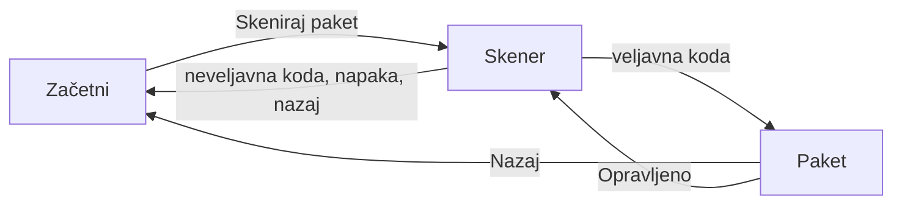
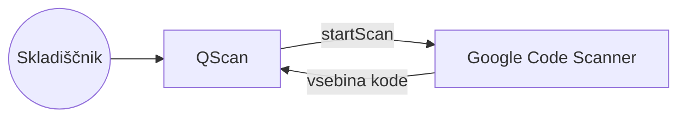
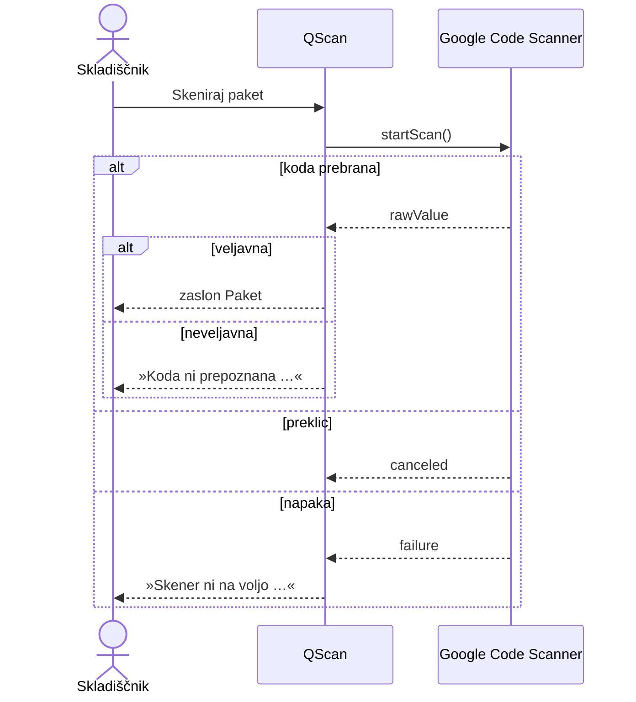
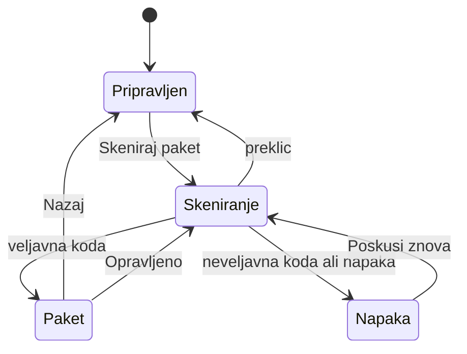

# QScan: funkcionalna specifikacija

Elektronsko in mobilno poslovanje, FRI 2026/27
Tilen Butara (63240036), Luka Ažman (63230009)

Stanje: 1. faza (osnovni prototip).

## 1. Uvod

QScan je Android aplikacija za skladiščne delavce. Delavec skenira QR-kodo na paketu, aplikacija pa pokaže številko paketa, datum, lokacijo in opravilo: pregled, premik ali odprema.

Vloga: skladiščnik.

V 1. fazi so vsi podatki zapisani v QR-kodi. Aplikacija nima prijave, strežnika, zgodovine skeniranj in urnika opravil. Ničesar ne shranjuje.

## 2. Uporabniške zgodbe

| ID | Zgodba | MoSCoW |
|---|---|---|
| US-01 | Kot skladiščnik želim s kamero skenirati QR-kodo na paketu, da mi podatkov ni treba iskati ročno. | Must |
| US-02 | Kot skladiščnik želim po skeniranju videti številko paketa, datum, lokacijo in opravilo, da vem, kaj moram narediti s paketom. | Must |
| US-03 | Kot skladiščnik želim obvestilo, kadar koda ni veljavna, da ne ukrepam na podlagi napačnih podatkov. | Must |
| US-04 | Kot skladiščnik želim po opravljenem koraku takoj skenirati naslednji paket, da hitreje obdelam več paketov. | Should |
| US-05 | Zgodovina skeniranj | Won't (2. faza) |
| US-06 | Urnik opravil | Won't (3. faza) |

```gherkin
Scenario: US-01 uspešno skeniranje
  Given skladiščnik je na začetnem zaslonu
  When tapne »Skeniraj paket« in skenira veljavno kodo
  Then se odpre zaslon paketa

Scenario: US-01 skener ni na voljo
  Given na napravi ni Google Play storitev
  When skladiščnik tapne »Skeniraj paket«
  Then se izpiše »Skener ni na voljo …« in gumb se glasi »Poskusi znova«

Scenario: US-02 prikaz paketa
  Given koda vsebuje {"v":1,"id":"PKG-000123","date":"2026-11-26","task":"MOVE","loc":"A-03-2"}
  When skladiščnik skenira kodo
  Then vidi »PKG-000123«, opravilo »Premik«, lokacijo »A-03-2« in datum »26. 11. 2026«

Scenario: US-02 manjkajoča neobvezna polja
  Given koda vsebuje samo "v", "id" in "task"
  When skladiščnik skenira kodo
  Then vidi številko paketa in opravilo, vrstic za datum, lokacijo in opombo ni

Scenario: US-03 koda ni QScan
  Given skladiščnik je na začetnem zaslonu
  When skenira kodo s spletnim naslovom ali kodo z "v":2
  Then ostane na začetnem zaslonu
  And izpiše se »Koda ni prepoznana kot QScan paket. Preveri nalepko in poskusi znova.«

Scenario: US-04 naslednji paket
  Given skladiščnik je na zaslonu paketa
  When tapne »Opravljeno, skeniraj naslednjega«
  Then se odpre skener

Scenario: US-04 preklic skeniranja
  Given skener je odprt
  When skladiščnik pritisne nazaj
  Then se vrne na začetni zaslon brez obvestila o napaki
```

## 3. Nefunkcionalne zahteve

| ID | Zahteva |
|---|---|
| NFR-01 | Zaslon paketa se prikaže v manj kot 1 s po skeniranju. |
| NFR-02 | Interaktivni elementi so veliki vsaj 48 × 48 dp. Kontrast besedila je vsaj 4,5 : 1 v svetli in temni temi. |
| NFR-03 | Neveljavna koda nikoli ne odpre zaslona paketa. Preverjajo jo enotski testi parserja. |
| NFR-04 | Deluje na Androidu 7.0 (API 24) ali novejšem z Google Play storitvami. |

Varnost in zasebnost (OWASP MASVS):

| Kategorija | Zahteva |
|---|---|
| PLATFORM | Aplikacija ne zahteva dovoljenja za kamero. Kamero upravlja Google Code Scanner, aplikacija dobi samo prebrano besedilo. |
| CODE | Vsebino kode aplikacija obravnava kot nezaupanja vreden vhod. Sprejme samo JSON, opisan v poglavju 6. |
| PRIVACY | Aplikacija ne zbira osebnih podatkov. |
| NETWORK | Aplikacija ne uporablja omrežja. Modul skenerja prenesejo Google Play storitve. |

## 4. Vmesnik

| Zaslon | Vsebina | Pokriva |
|---|---|---|
| Začetni | Navodilo, gumb »Skeniraj paket«, obvestilo o napaki | US-01, US-03 |
| Skener | Googlov zaslon s kamero | US-01 |
| Paket | Številka, opravilo z navodilom, lokacija, datum, opomba, gumb »Opravljeno« | US-02, US-04 |



## 5. Arhitektura



Aplikacija ima eno aktivnost z dvema Compose zaslonoma. Funkcija `parsePackage` prebere vsebino kode. V 2. fazi dobi aplikacija ViewModel, repozitorij in povezavo na strežnik (Node.js, MariaDB).

V prijavi je bil naveden »Microsoft QR Code Scan Kit«, ki za Android ne obstaja. Uporabljava Google Code Scanner.

## 6. Podatki

QR-koda vsebuje JSON:

| Polje | Tip | Obvezno | Omejitve |
|---|---|---|---|
| `v` | število | da | samo `1` |
| `id` | niz | da | ne sme biti prazen |
| `task` | niz | da | `INSPECT`, `MOVE` ali `SHIP` |
| `date` | niz | ne | `YYYY-MM-DD` |
| `loc` | niz | ne | lokacija v skladišču |
| `note` | niz | ne | dodatno navodilo |

Primer: `{"v":1,"id":"PKG-000123","date":"2026-11-26","task":"MOVE","loc":"A-03-2","note":"Krhko, ne zlagaj."}`

Testne kode: [`docs/test-qr/`](test-qr/).

## 7. Zunanji vmesniki

| | Google Code Scanner (`play-services-code-scanner` 16.1.0) |
|---|---|
| Namen | branje QR-kode s kamero |
| Klic | `GmsBarcodeScanning.getClient(context, options).startScan()` |
| Odgovor | `Barcode.rawValue` |
| Dovoljenja | jih ni |
| Napake | preklic: brez obvestila; napaka: »Skener ni na voljo …« |

## 8. Dinamika





## 9. Sledljivost

| Zgodba | Zaslon | Koda | Test |
|---|---|---|---|
| US-01 | Začetni, Skener | `MainActivity.kt` | testne kode 01–03 |
| US-02 | Paket | `PackageScreen.kt`, `PackageInfo.kt` | `PackageParserTest` |
| US-03 | Začetni | `ScanScreen.kt`, `PackageInfo.kt` | `PackageParserTest`, testni kodi 04–05 |
| US-04 | Paket, Skener | `MainActivity.kt` | ročno |
